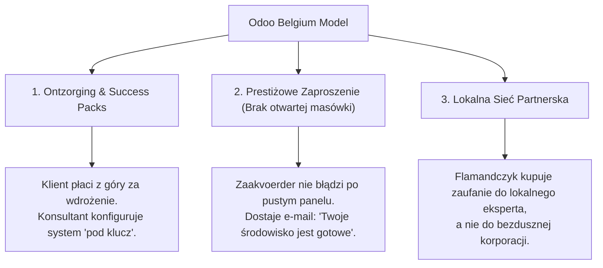
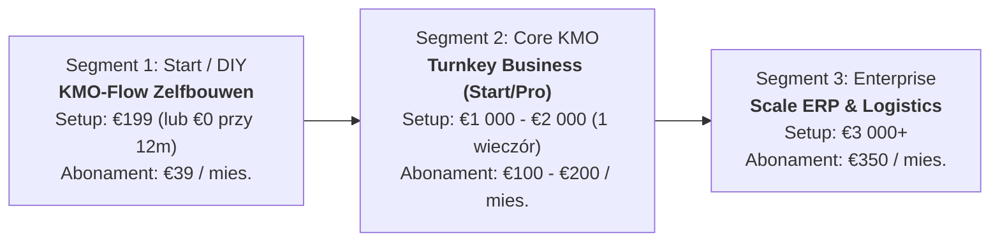
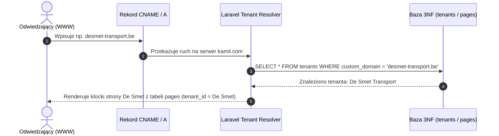
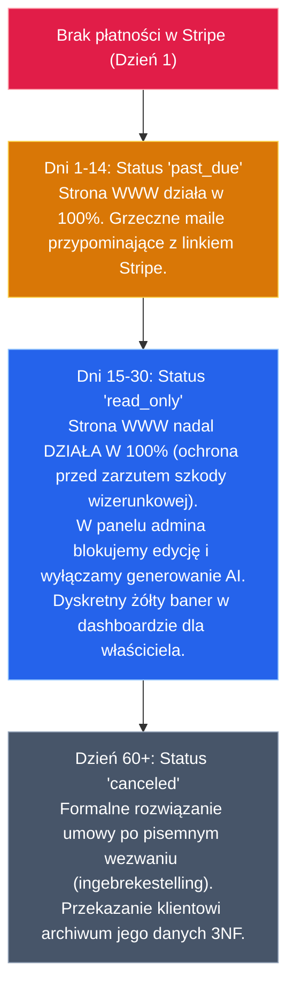

# KMO-Flow: Biznesowy Blueprint Architektoniczny (Flandria & WaaS)
> **Ziemkiewicz Digital / KMO-Flow Platform — Roeselare, West-Vlaanderen**  
> *Wersja dokumentu: 1.0 (Oficjalna strategia operacyjno-technologiczna)*  
> *Data zatwierdzenia: 2026-10-23*

---

## 1. Wprowadzenie i Misja Biznesowa

Rynek mikro- i małych przedsiębiorstw (KMO / Zelfstandigen) we Flandrii stoi przed potężną barierą technologiczną:
1. Tradycyjne agencje interaktywne w Belgii pobierają wygórowane stawki (od 3 500 € do 8 000 € za prostą stronę, plus 85 €–120 € za każdą roboczogodzinę zmian).
2. Tanie rozwiązania DIY (Wix, czysty WordPress) frustrują zapracowanych przedsiębiorców brakiem czasu, skomplikowaną obsługą, podatnościami wtyczek i brakiem lokalnej zgodności (Peppol B2B, KBO, RPR).

**KMO-Flow (Ziemkiewicz Digital)** wypełnia tę lukę poprzez unikalną hybrydę:
* **Dla Klienta:** Pełne odciążenie z problemów technicznych (*„Ontzorging”*) lub prosty kreator klockowy (*„Zelfbouwen”*),
* **Dla Agencji:** Błyskawiczne wdrożenia w jeden wieczór (efektywna stawka 300 €–500 €/godz.), powtarzalny miesięczny przychód abonamentowy (MRR) oraz zoptymalizowany monolit multi-tenant 3NF.

---

## 2. Inżynieria Wsteczna Sukcesu Odoo w Belgii

Firma Odoo (wyceniana na ponad 5 mld € z siedzibą w Brabancji Walońskiej) nie odniosła sukcesu dzięki oferowaniu „darmowego oprogramowania do samodzielnego klikania”. Przeanalizowaliśmy mechanizmy ich dominacji we Flandrii i przenieśliśmy je do KMO-Flow:



### Przełożenie na KMO-Flow:
* **Zamknięta rejestracja publiczna:** Nie tworzymy otwartego formularza `/register` dla spamu. Wyceniamy się jako usługa klasy premium.
* **Lead Generation przez Demo Sandbox:** Klient prosi o niezobowiązujące demo (*„Vraag een vrijblijvende CMS Demo aan”*), co dostarcza nam zweryfikowany kontakt biznesowy (telefon, KBO, branża).
* **Aktywacja „Zaproś do stołu”:** Super-Admin tworzy gotowe środowisko jednym kliknięciem, a klient dostaje eleganckie zaproszenie do ustalenia hasła (*„Stel uw wachtwoord in”*).

---

## 3. Matryca Produktowa: Trzy Poziomy Ofertowe (Drabina Cenowa)

Aby zagospodarować zarówno zamożne firmy szukające pełnej obsługi, jak i mniejszych przedsiębiorców z ograniczonym budżetem, wprowadzamy **trójstopniową drabinę wartości**:



### Szczegółowa specyfikacja pakietów:

| Parametr | 1. KMO-Flow Zelfbouwen | 2. Turnkey Business (Start/Pro) | 3. Scale Enterprise & ERP |
|---|---|---|---|
| **Profil Klienta** | Jednoosobowa działalność, fryzjerka, początkujący rzemieślnik | Standardowa firma (transport, instalator, hodowla, gabinet) | Średnia firma z flotą, handlem B2B i wymogami Peppol |
| **Opłata Setup (Wdrożenie)** | **199 €** (15 min pracy szablonowej) | **1 000 € – 2 000 €** (wdrożenie w 1 wieczór) | **3 000 €+** (indywidualne integracje) |
| **Abonament Miesięczny (MRR)** | **39 € / mies.** | **100 € – 200 € / mies.** | **350 € / mies.** |
| **Kto buduje stronę?** | Klient sam w naszym Page Builderze | **Ziemkiewicz Digital (Gotowiec w 1 wieczór)** | Ziemkiewicz Digital + audyt procesów |
| **Katalog Produktów/Usług** | Do 15 pozycji | Bez limitu + kategoryzacja | Bez limitu + stany magazynowe / warianty |
| **Autonomiczny Blog AI** | Opcjonalny add-on (+19 €/mc) | **W cenie (4–12 artykułów/mc)** | **W cenie (30 artykułów/mc + social snippets)** |
| **Fakturowanie Peppol BIS 3.0** | Brak (lub proste PDF) | Podstawowe | **Pełne B2B Peppol UBL + KBO Lookup** |
| **Wsparcie techniczne** | Baza wiedzy + płatne 45 €/h | Drobne korekty w cenie (do 30 min/mc) | Priorytetowe SLA 4h + dedykowany opiekun |

---

## 4. Architektura Autorskiego Kreatora „Zelfbouwen” (Zero WordPressa)

Odrzucamy instalację obcego oprogramowania WordPress z uwagi na dług technologiczny, awaryjność wtyczek i luki bezpieczeństwa. Zamiast tego wdrażamy **nasz własny, zintegrowany edytor blokowy (Modular Site Builder)** w oparciu o kolumnę `pages.blocks` (JSON).

### Dostępne Bloki Modułowe:
1. `HeroBlock`: Nagłówek, podtytuł, zdjęcie w tle, 2 przyciski akcji (CTA).
2. `AboutBlock`: Sekcja „O nas”, zdjęcie założyciela, historia firmy.
3. `ServicesBlock`: Siatka 3–4 kafelków usług z ikonami Heroicons.
4. `CatalogGridBlock`: Dynamiczne zaciąganie produktów z tabeli `catalog_items` z cenami w centach i przyciskiem WhatsApp.
5. `TestimonialsBlock`: Opinie klientów z gwiazdkami Google.
6. `ContactFormBlock`: Zintegrowany formularz zapisujący rekordy do tabeli `leads` w czasie rzeczywistym (Reverb WebSockets).
7. `FaqAccordionBlock`: Rozwijane pytania i odpowiedzi (SEO Schema FAQ).

### Dlaczego Zelfbouwen to żyła złota dla Agencji (Mechanizm Naturalnego Upsellu):
Klient kupujący pakiet Zelfbouw sam zaczyna układać stronę. Po 2–3 dniach, gdy dochodzi do wniosku, że brakuje mu umiejętności copywriterskich lub graficznych, widzi w panelu przycisk:
> **„Hulp nodig? Laat onze expert uw pagina finetunen voor €45/uur.”**  
*(Potrzebujesz pomocy? Zleć dopracowanie strony naszemu ekspertowi za 45 €/godz.).*

Klient sam dobrowolnie dokupuje 2–4 godziny pracy doradczej, płacąc dodatkowo 90 €–180 € bez żadnych negocjacji.

---

## 5. Wielodostępność Techniczna & Routing Domenowy

Wszystkie witryny klientów oraz strona główna agencji działają na **jednej instancji kodu i jednej zoptymalizowanej bazie 3NF**.



1. **Domena własna klienta:** Klient dodaje w swoim DNS rekord `CNAME -> kamil.com` lub `A -> IP_SERWERA`.
2. **Subdomena techniczna:** Przed podpięciem domeny klient ma dostęp pod adresem: `desmet.kamil.com`.
3. **Panel Administracyjny:** Klient loguje się na `kamil.com/dashboard` (lub `desmet-transport.be/dashboard`). Filament v3 na podstawie tabeli `tenant_user` izoluje jego uprawnienia.

---

## 6. Architektura API i Kontrola Kosztów AI (Gemini Telemetry & Quotas)

Aby wykluczyć ryzyko niekontrolowanego generowania kosztów na wspólnym kluczu API, zastosowano architekturę trójpoziomowej ochrony w oparciu o tabelę `ai_generation_logs`:

### 1. Rejestracja Zużycia w Czasie Rzeczywistym:
Każde wywołanie modelu zapisuje w bazie:
* `tenant_id` — identyfikator firmy,
* `input_tokens` oraz `output_tokens` — zużycie tokenów,
* `estimated_cost_micro_usd` — wyliczony koszt w mikro-dolarach ($0.000001).

### 2. Twarde Limity Pakietowe (*Hard Quotas*):
Przed wysłaniem zapytania do Google Gemini serwis weryfikuje limit miesięczny:
* **Pakiet Zelfbouw (39 €/mc):** 0 artykułów AI (lub 1 próbny na start).
* **Pakiet Start (100 €/mc):** Max 4 artykuły / miesiąc (1 wpis na tydzień).
* **Pakiet Pro (200 €/mc):** Max 12 artykułów / miesiąc (3 wpisy na tydzień).
* **Pakiet Scale (350 €/mc):** Max 30 artykułów / miesiąc (codzienny wpis).

Próba przekroczenia limitu zwraca w panelu komunikat o możliwości dokupienia pakietu doładowania (*AI Booster Pack*).

### 3. Model BYOK (Bring Your Own Key) dla Klientów Enterprise:
W kolumnie `tenants.settings` system obsługuje pole `custom_gemini_api_key`. Jeśli klient korporacyjny chce generować setki tekstów miesięcznie, wpisuje swój klucz API z Google Cloud Console — koszty obciążają bezpośrednio jego kartę, a agencja ma 0 € kosztów zewnętrznych.

---

## 7. Standardy Prawne i Polityka SLA we Flandrii

W prawie belgijskim (*Wetboek van economisch recht / Code de droit économique*) niedopuszczalne jest natychmiastowe zablokowanie publicznej strony klienta z publicznym komunikatem o braku płatności.

Wdrażamy **Wzorzec Stopniowej Degradacji Uprawnień (*Gradual Degradation*)**:



### Granica Odpowiedzialności w Umowie (Algemene Voorwaarden SLA):
1. **Agencja Ziemkiewicz Digital gwarantuje:** Dostępność infrastruktury (*Uptime 99.8%*), certyfikaty SSL, codzienne kopie zapasowe, aktualizacje bezpieczeństwa frameworka.
2. **Klient odpowiada za:** Prawidłowość wprowadzanych treści, legalność zdjęć i opisów produktów, zgodność z prawem handlowym.
3. **Pomoc techniczna:** Standardowe poprawki wykraczające poza awarie serwera rozliczane są stawką godzinową **45 € – 65 € / godz. netto**.

---

## 8. Magazyn Mediów i Dokumentów (Decoupled Object Storage)

* Baza SQL (15 GB) służy wyłącznie do przechowywania tekstu i liczb w relacjach 3NF.
* Zdjęcia (`media`), faktury PDF i dokumenty Peppol XML składowane są na dysku.
* Dzięki kolumnie `media.disk` (`default 'public'`), aplikacja na początku korzysta z dysku lokalnego, a po przekroczeniu progu 50 klientów następuje bezinwazyjne przełączenie na **Cloudflare R2** (0 € opłat za transfer) lub **Hetzner S3** bez dotykania kodu bazy danych.

---

---

## 10. Architektura Dual-Execution (Action-First): Człowiek + Autonomiczny Agent AI

Aby platforma KMO-Flow mogła być obsługiwana zarówno **ręcznie przez człowieka** (Ciebie lub przyszłego pracownika low-code w panelu Filament v3), jak i **autonomicznie przez Agenta AI**, wdrażamy wzorzec **Dual-Execution (Action-First Architecture)**:

```mermaid
graph TD
    subgraph INICJATOR ZADANIA
        Human["👤 CZŁOWIEK<br/>(Ty lub pracownik w Filament Dashboard)"]
        Agent["🤖 AGENT AI<br/>(Function Calling / WhatsApp Bot / Cron)"]
    end

    subgraph WARSTWA AKCJI BIZNESOWYCH (PHP Service Actions)
        A1["ProvisionTenantAction<br/>(Tworzy tenanta, usera, generuje szablon w pages)"]
        A2["BuildPageBlocksAction<br/>(Zapisuje strukturę klocków JSON w pages.blocks)"]
        A3["CreateCatalogItemAction<br/>(Dodaje produkt/usługę z ceną w centach)"]
        A4["GenerateBlogPostAction<br/>(Generuje wpis z sekcjami JSON i telemetrią)"]
        A5["IssueCommercialDocumentAction<br/>(Wystawia fakturę Peppol / ofertę)"]
    end

    subgraph BAZA DANYCH 3NF
        DB[("Baza 3NF<br/>tenants, users, pages, catalog_items, posts")]
        Audit["Dziennik audit_logs<br/>(Zapisuje czy akcję wykonał Człowiek czy Agent)"]
    end

    Human -->|Formularz / Modal w Filament| A1
    Human -->|Edytor Drag & Drop| A2
    Human -->|Formularz w Aanbod| A3

    Agent -->|JSON Tool Calling| A1
    Agent -->|Parsowanie PDF / tekstu klienta| A2
    Agent -->|Wiadomość z WhatsApp| A3
    Agent -->|Nocny harmonogram ai_schedules| A4

    A1 --> DB
    A2 --> DB
    A3 --> DB
    A4 --> DB
    A5 --> DB

    A1 -.-> Audit
    A2 -.-> Audit
    A3 -.-> Audit
```

### Gdzie dokładnie w kodzie powstaje „blanko layout / szablon strony”?
Logika ta znajduje się w klasie akcji:
👉 **`app/Actions/Tenants/ProvisionTenantAction.php`**

Gdy akcja ta jest wywoływana (przez kliknięcie w panelu LUB przez wywołanie Agenta), wykonuje atomowo:
1. **Tworzy Tenanta (`tenants`):** Zapisuje nazwę firmy, NIP, domenę i status (`active` lub `pending`).
2. **Tworzy Właściciela (`users` & `tenant_user`):** Rejestruje konto zaakvoerdera i łączy z firmą rolą `owner`.
3. **Automatycznie generuje stronę główną (`pages`):**
   ```php
   Page::create([
       'tenant_id'    => $tenant->id,
       'title'        => 'Home',
       'slug'         => 'home',
       'is_homepage'  => true,
       'is_published' => true,
       'blocks'       => TemplateBlocks::getForNiche($niche), // <-- TUTAJ POWSTAJE LAYOUT KLOCKÓW!
   ]);
   ```
4. **Wgrywa domyślne stawki podatkowe (`tax_rates`):** Peppol `BE_21`, `BE_12`, `BE_6`, `BE_0_MC`.
5. **Wysyła e-mail powitalny:** Z bezpiecznym linkiem do ustawienia hasła przez klienta.

### Rejestr Narzędzi Agenta (Agent Tools / Function Calling Schema):
Każda akcja biznesowa posiada zdefiniowany schemat parametrów JSON, dzięki czemu dowolny model AI (Gemini, Claude, GPT) może wywołać ją bezpośrednio jako tzw. *Tool*:
* `tool_provision_tenant(company_name, vat_number, email, plan, niche_template)`
* `tool_build_page_blocks(tenant_id, page_slug, blocks_json)`
* `tool_create_catalog_item(tenant_id, name, price_cents, attributes_json)`
* `tool_generate_blog_post(tenant_id, topic_prompt, auto_publish)`

### Tryb Bezpieczeństwa: Human-in-the-Loop (`requires_approval`):
Dla operacji o kluczowym znaczeniu (zmiana układu strony głównej, wystawienie oficjalnej faktury), Agent może działać w trybie **Draft**:
* Agent przygotowuje stronę ze statusem `draft`.
* W panelu Super-Admina pojawia się powiadomienie: *„Agent przygotował propozycję strony dla De Smet Transport. [Przejrzyj klocki i zatwierdź]”*.
* Człowiek rzuca okiem, ewentualnie poprawia jeden detal i klika *Zatwierdź*.

